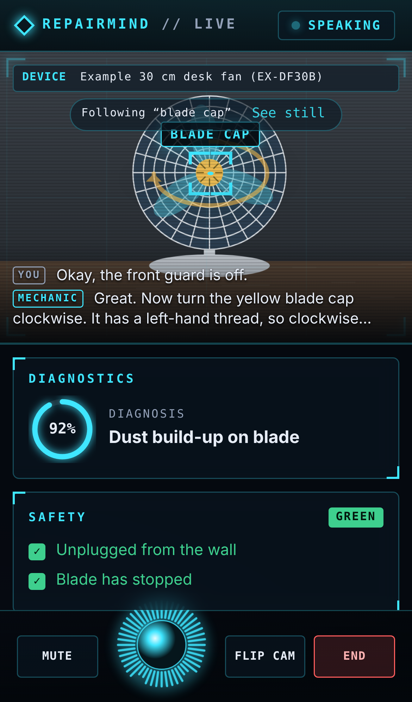
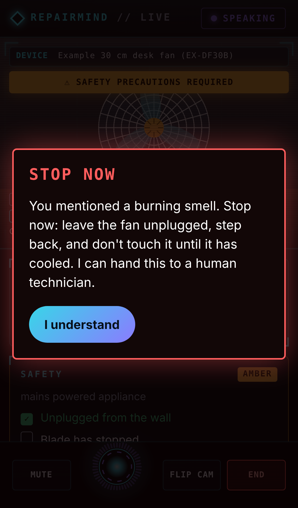
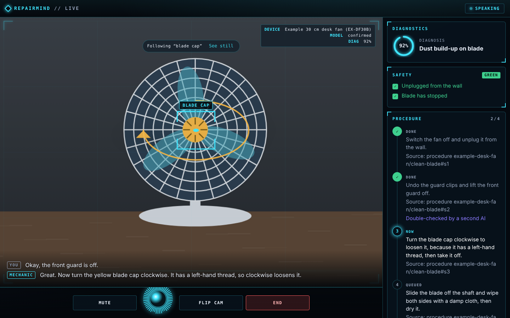

# RepairMind X

A live video call with an AI mechanic, on phone, tablet or desktop. The user points the camera at the
broken thing and talks; the mechanic diagnoses by asking questions and running safe tests, then talks
them through the fix one checked step at a time.

```
Browser (phone / desktop)  ──WebRTC──>  LiveKit room  <──  Mechanic agent (Python, LiveKit Agents)
  camera + mic, captions,                                   Gemini Live: hears, sees ~1 fps, speaks
  checklist, freeze-frame arrows  <── data topics ──        Tools ─> safety rules + session gates
         │                                                        └> iFixit guide lookup
         └─ POST /api/token ─> token server (FastAPI)
```

## What's in Phase 1

| Part | Where | What it does |
|---|---|---|
| Safety rules | `agent/repairmind/safety.py` | Green, amber and red levels in plain code. Red jobs (microwave internals, mains wiring, gas, refrigerant, airbags, brakes, fuel, high-voltage or swollen batteries, CRTs, medical devices, bypassing interlocks, torsion springs) get no step-by-step instructions. Amber jobs need precautions seen on camera. Also detects irreversible actions and hazard words. |
| Session gates | `agent/repairmind/session.py` | Device identification, history questions, safe tests, hypotheses, a diagnosis that's refused until there's evidence and the top causes are clearly separated, confidence thresholds (0.75 green, 0.85 amber, 0.90 irreversible), sourced steps only, the 5-point irreversible-step check, step verification before the next step, hazard stop, escalation package, save and resume. |
| Mechanic agent | `agent/repairmind/agent.py` | LiveKit Agents worker with Gemini Live (voice and video in, voice out). Every repair step goes through a tool backed by the gates above. A transcript watcher stops the call on hazard words even if the model misses them. |
| Guide lookup | `agent/repairmind/sources.py` | iFixit search and guide steps. |
| Token server | `agent/repairmind/token_server.py` | Issues LiveKit join tokens, dispatches the mechanic, and lets a dropped call resume in the same room. |
| Web app | `web/` | React + LiveKit. Safety and privacy notice, rear camera by default, camera switch, mute, live captions, agent state, risk banner, diagnosis with confidence, precautions and step checklist, freeze-frame arrows, hazard and refusal alerts, resume last repair. Installable as a PWA. |

## Phase 2: grounded steps

| Part | Where | What it does |
|---|---|---|
| Second-model cross-check | `agent/repairmind/reviewer.py` | Before the first repair step and every amber or irreversible step, Claude (a different model from the Gemini voice) reviews the evidence, the step, its source excerpt and the latest camera frame. It answers approve, revise or escalate. If it disagrees, the step is blocked. If it can't run (no key, network, refusal), risky steps are blocked: it fails closed. |
| Speech guard | `agent/repairmind/speech_guard.py` | Reads every finished mechanic utterance. If it gave a hands-on instruction with no active step, an irreversible action without confirmation, or anything for a red-level job, the agent interrupts itself and corrects out loud. |
| Service manuals | `agent/repairmind/manuals.py`, `POST /api/manual` | Upload the device's PDF manual during the call ("Add manual" button). It is split into page-tagged passages and searched with BM25, so steps cite "manual p.N". |
| Full-resolution frames | `agent/repairmind/frames.py` | Keeps the newest full camera frame for the reviewer (and Phase 3 close-ups). |

## Phase 3: visual guidance

| Part | Where | What it does |
|---|---|---|
| Label reading | `read_label` tool, `agent/repairmind/vision.py` | Reads brand and exact model from the rating label on a full-resolution frame. If any character is uncertain it asks for a better shot rather than guessing. |
| Close-ups | `look_closer` tool | Answers detail questions ("is the ribbon cable fully seated?") from a full-resolution frame. |
| Precise markers | `point_at` tool | Locates the part on the newest full frame and sends that exact frame to the app with a box and arrow. Falls back to an approximate marker, clearly labelled, if precise location is unavailable. |
| Two-frame step checks | `check_step_on_camera` tool | Two frames about a second apart must both show the step done with at least 0.8 confidence and no problems seen. Required before amber or irreversible steps count as done. Unclear three times means hand off to a human. |

Vision uses the same checking model as the cross-check: free Gemini (`RMX_GEMINI_CHECK_MODEL`) by default, or Claude if `ANTHROPIC_API_KEY` is set. With neither, risky steps can't be verified on camera, so they are blocked.

## Phase 4: expert mode

When the confirmed model matches a supported product, the mechanic switches from general guides to that
product's own reviewed procedures.

| Part | Where | What it does |
|---|---|---|
| Product registry | `agent/products/<id>/product.yaml`, `agent/repairmind/expert/products.py` | How to recognise the product (brand + model regex), its parts for the 3D view, an optional detector, and procedures as structured steps. A step whose text reads irreversible must be flagged so, or the file fails to load. |
| Reviewed procedures only | `get_expert_procedure` tool, `source_kind="procedure"` | Procedures are served only when `reviewed_by` and `reviewed_on` are filled in by a qualified person. The mechanic must say each step word for word; any paraphrase is blocked. `RMX_ALLOW_UNREVIEWED=1` loads drafts for demos, and they are labelled as unreviewed. |
| Trained defect detector | `run_defect_detector` tool, `agent/repairmind/expert/detector.py` | Anomalib PatchCore (or the original ResNet-50 + autoencoder weights). Each product has two thresholds from its own validation set: good, defective, and an "uncertain" band in between that means "get a better view". The heatmap is shown on a frozen frame. |
| Training script | `agent/scripts/train_detector.py` | Trains PatchCore on your own photos of good units, picks both thresholds at 99% coverage, and refuses to write a config if good and defective don't separate. |
| 3D step viewer | `web/src/Viewer3D.tsx`, `GET /api/products/{id}` | Shows each procedure step on a 3D model: highlighted parts, exploded moves, hidden parts, replay. Uses a GLB from real CAD if `model_url` is set; otherwise simple shapes with an "Illustrative model" badge. |

`agent/products/example-desk-fan` is a made-up example to copy. It is not a real product and its procedure
is not reviewed. Detector extras: `uv pip install -e ".[detector]"` (torch, torchvision, anomalib).

## Phase 5: bulk inspection

For factories, repair shops and refurbishers: check many units of one product at once.

| Part | Where | What it does |
|---|---|---|
| Upload | web app, "Bulk inspection" link (`#inspect`) | Pick a product that has a trained detector, add photos or ZIPs (up to 5,000 images), watch progress, filter by verdict. |
| Batch engine | `agent/repairmind/inspection/batch.py` | Runs in the background. Every file gets a row: good, defective, uncertain (for a person to check) or unreadable. Nothing is silently skipped. If the detector itself is broken, the job stops instead of filling the report with noise. ZIP paths are sanitised and sizes capped. |
| Excel report | `agent/repairmind/inspection/report.py` | Six sheets: Summary (counts, chart, thresholds), All items (filterable), Defective (with heatmaps), Needs review (with columns for a person's decision), Scores (histogram against the thresholds), Method (how verdicts were made and what they don't prove). |
| API | `POST /api/inspections`, `GET /api/inspections/{id}`, `GET /api/inspections/{id}/report.xlsx` | Off unless `RMX_INSPECTION_TOKEN` is set in `agent/.env`; then every call needs `Authorization: Bearer <token>`. |

Bulk inspection needs a trained detector for the product (Phase 4, `scripts/train_detector.py`). The example
product has none, so it shows as "no trained detector yet".

## Live AR

When the mechanic points at a part, the box, label and any motion arrow stay on the real part in the live
video as the phone moves. Previously they were drawn on a frozen still.

| Part | Where | What it does |
|---|---|---|
| Tracker | `web/src/ar/tracker.ts`, run in a Web Worker | Pyramidal Lucas-Kanade optical flow on corner features inside the box, checked forward and backward every frame. About 7 ms per frame on a laptop, run at about 12 fps. |
| Catch-up | `catchUp()` | The server locates the part on a frame that is a few seconds old. The phone keeps about 4 s of recent frames, finds the matching one and follows the part forward to "now". |
| Honest failure | `ARLayer.tsx` | If too few features survive, the app says "lost" and draws nothing, rather than a box in the wrong place. The agent then re-finds the part on a fresh frame, at most 3 times and at least 4 s apart. If tracking can't start, it falls back to the still picture. |
| Motion arrows | `point_at(action=...)`, `agent/repairmind/ar.py` | Shows turn clockwise/anticlockwise, press, pull, lift and slide arrows only for the step the safety gates have already made active. They disappear when that step ends, and nothing is drawn during a hazard stop or alert. |

WebXR is deliberately not used. An immersive AR session takes over the camera, so the video to the
mechanic would stop and it could no longer watch what the user is doing. That is not acceptable for
a safety-checked repair. Tracking runs on the normal camera stream instead, so it works on any phone browser.

## Interface

The call screen is a dark holographic HUD. It has:
- corner brackets and a scan line over the live camera
- a voice orb that reacts to the mechanic's voice when it speaks and to your mic when it listens
- glass panels for the diagnosis confidence gauge, safety status and step timeline
- AR markers drawn as targeting brackets

Safety banners and the stop alert stay solid amber and red and are never see-through. Animations respect "reduce motion". On phones the HUD keeps to the edges so the camera stays clear.

| Phone call | Safety alert | Desktop |
|---|---|---|
|  |  |  |

## Run it

You need: a free LiveKit Cloud project (URL, API key, secret) and a free Google AI Studio API key. That's all; the app runs entirely on free tiers.

**Free vs paid checking.** The second-opinion review, label reading, part markers and camera step checks use a separate Gemini model (`gemini-3.5-flash` by default; Google no longer offers `gemini-2.5-flash` to new keys) on the Google free tier, with the same key as the live voice. The rules are identical either way: a disagreement, an error or a used-up free quota blocks the risky step, it never lets it through. Adding an optional `ANTHROPIC_API_KEY` switches these checks to Claude, which is a fully independent model family and the stronger second opinion; `RMX_CHECK_PROVIDER` forces one or the other. The free tier has per-minute and daily limits, so a long session can hit them; when it does, risky steps wait or are handed to a human rather than going ahead unchecked.

```bash
# 1. Agent + token server
cd agent
cp .env.example .env            # fill in the keys
uv venv && uv pip install -e ".[dev]"
.venv/bin/python -m pytest
.venv/bin/python -m repairmind.agent dev          # terminal 1: the mechanic
.venv/bin/uvicorn repairmind.token_server:app --port 8000   # terminal 2

# 2. Web app
cd ../web
npm install
npm run dev                     # open the printed URL; on a phone use the network URL over HTTPS
```

Phones only allow camera access over HTTPS (or localhost). For phone testing, deploy the web app (any
static host) or use a tunnel such as `cloudflared tunnel --url http://localhost:5173`.

## Known limits of Phase 1

- **Not yet tested against live services.** The safety rules, gates and token server are covered by
  unit tests, and the web app builds. The end-to-end call needs the LiveKit and Gemini keys, and the
  iFixit lookup was not reachable from the build machine.
- **The speech guard acts after the sentence is spoken.** It interrupts and corrects within about a
  second, but the words were already heard. It also allows any instruction while a step is active.
- **Markers use freeze-frame.** The box is drawn on the exact frame that was analysed, not the moving
  live video. Live tracking of markers is not built yet.
- **iFixit licence.** Guides are CC BY-NC-SA. Fine for this prototype; a commercial launch needs
  iFixit's paid API plan, and their content may not be used to train models.
- **Safety keywords are English only** for now.
- **Manuals must have a text layer.** Scanned PDFs are rejected; OCR would come later.
- **The token server and agent share a disk** for uploaded manuals, so run them on the same machine
  (or point `RMX_SESSIONS_DIR` at shared storage).
