# RepairMind X

A live video call with an AI mechanic, on phone, tablet or desktop. The user points the camera at the
broken thing and talks; the mechanic diagnoses by asking questions and running safe tests, then talks
them through the fix one checked step at a time.

```
Browser (phone / desktop)  ──WebRTC──>  LiveKit room  <──  Mechanic agent (Python, LiveKit Agents)
  camera + mic, captions,                                   Gemini Live: hears, sees ~1 fps, speaks
  checklist, freeze-frame arrows  <── data topics ──        Tools ─> safety rules + session gates
         │                                                        └> iFixit guide lookup
         └─ POST /api/token ─> token server (FastAPI)
```

## What's in Phase 1

| Part | Where | What it does |
|---|---|---|
| Safety rules | `agent/repairmind/safety.py` | Green, amber and red levels in plain code. Red jobs (microwave internals, mains wiring, gas, refrigerant, airbags, brakes, fuel, high-voltage or swollen batteries, CRTs, medical devices, bypassing interlocks, torsion springs) get no step-by-step instructions. Amber jobs need precautions seen on camera. Also detects irreversible actions and hazard words. |
| Session gates | `agent/repairmind/session.py` | Device identification, history questions, safe tests, hypotheses, a diagnosis that's refused until there's evidence and the top causes are clearly separated, confidence thresholds (0.75 green, 0.85 amber, 0.90 irreversible), sourced steps only, the 5-point irreversible-step check, step verification before the next step, hazard stop, escalation package, save and resume. |
| Mechanic agent | `agent/repairmind/agent.py` | LiveKit Agents worker with Gemini Live (voice and video in, voice out). Every repair step goes through a tool backed by the gates above. A transcript watcher stops the call on hazard words even if the model misses them. |
| Guide lookup | `agent/repairmind/sources.py` | iFixit search and guide steps. |
| Token server | `agent/repairmind/token_server.py` | Issues LiveKit join tokens, dispatches the mechanic, and lets a dropped call resume in the same room. |
| Web app | `web/` | React + LiveKit. Safety and privacy notice, rear camera by default, camera switch, mute, live captions, agent state, risk banner, diagnosis with confidence, precautions and step checklist, freeze-frame arrows, hazard and refusal alerts, resume last repair. Installable as a PWA. |

## Phase 2: grounded steps

| Part | Where | What it does |
|---|---|---|
| Second-model cross-check | `agent/repairmind/reviewer.py` | Before the first repair step and every amber or irreversible step, Claude (a different model from the Gemini voice) reviews the evidence, the step, its source excerpt and the latest camera frame. It answers approve, revise or escalate. If it disagrees, the step is blocked. If it can't run (no key, network, refusal), risky steps are blocked: it fails closed. |
| Speech guard | `agent/repairmind/speech_guard.py` | Reads every finished mechanic utterance. If it gave a hands-on instruction with no active step, an irreversible action without confirmation, or anything for a red-level job, the agent interrupts itself and corrects out loud. |
| Service manuals | `agent/repairmind/manuals.py`, `POST /api/manual` | Upload the device's PDF manual during the call ("Add manual" button). It is split into page-tagged passages and searched with BM25, so steps cite "manual p.N". |
| Full-resolution frames | `agent/repairmind/frames.py` | Keeps the newest full camera frame for the reviewer (and Phase 3 close-ups). |

## Phase 3: visual guidance

| Part | Where | What it does |
|---|---|---|
| Label reading | `read_label` tool, `agent/repairmind/vision.py` | Reads brand and exact model from the rating label on a full-resolution frame. If any character is uncertain it asks for a better shot rather than guessing. |
| Close-ups | `look_closer` tool | Answers detail questions ("is the ribbon cable fully seated?") from a full-resolution frame. |
| Precise markers | `point_at` tool | Locates the part on the newest full frame and sends that exact frame to the app with a box and arrow. Falls back to an approximate marker, clearly labelled, if precise location is unavailable. |
| Two-frame step checks | `check_step_on_camera` tool | Two frames about a second apart must both show the step done with at least 0.8 confidence and no problems seen. Required before amber or irreversible steps count as done. Unclear three times means hand off to a human. |

Vision uses the same checking model as the cross-check: free Gemini (`RMX_GEMINI_CHECK_MODEL`) by default, or Claude if `ANTHROPIC_API_KEY` is set. With neither, risky steps can't be verified on camera, so they are blocked.

## Phase 4: expert mode

When the confirmed model matches a supported product, the mechanic switches from general guides to that
product's own reviewed procedures.

| Part | Where | What it does |
|---|---|---|
| Product registry | `agent/products/<id>/product.yaml`, `agent/repairmind/expert/products.py` | How to recognise the product (brand + model regex), its parts for the 3D view, an optional detector, and procedures as structured steps. A step whose text reads irreversible must be flagged so, or the file fails to load. |
| Reviewed procedures only | `get_expert_procedure` tool, `source_kind="procedure"` | Procedures are served only when `reviewed_by` and `reviewed_on` are filled in by a qualified person. The mechanic must say each step word for word; any paraphrase is blocked. `RMX_ALLOW_UNREVIEWED=1` loads drafts for demos, and they are labelled as unreviewed. |
| Trained defect detector | `run_defect_detector` tool, `agent/repairmind/expert/detector.py` | Anomalib PatchCore (or the original ResNet-50 + autoencoder weights). Each product has two thresholds from its own validation set: good, defective, and an "uncertain" band in between that means "get a better view". The heatmap is shown on a frozen frame. |
| Training script | `agent/scripts/train_detector.py` | Trains PatchCore on your own photos of good units, picks both thresholds at 99% coverage, and refuses to write a config if good and defective don't separate. |
| 3D step viewer | `web/src/Viewer3D.tsx`, `GET /api/products/{id}` | Shows each procedure step on a 3D model: highlighted parts, exploded moves, hidden parts, replay. Uses a GLB from real CAD if `model_url` is set; otherwise simple shapes with an "Illustrative model" badge. |

`agent/products/example-desk-fan` is a made-up example to copy. It is not a real product and its procedure
is not reviewed. Detector extras: `uv pip install -e ".[detector]"` (torch, torchvision, anomalib).

## Phase 5: bulk inspection

For factories, repair shops and refurbishers: check many units of one product at once.

| Part | Where | What it does |
|---|---|---|
| Upload | web app, "Bulk inspection" link (`#inspect`) | Pick a product that has a trained detector, add photos or ZIPs (up to 5,000 images), watch progress, filter by verdict. |
| Batch engine | `agent/repairmind/inspection/batch.py` | Runs in the background. Every file gets a row: good, defective, uncertain (for a person to check) or unreadable. Nothing is silently skipped. If the detector itself is broken, the job stops instead of filling the report with noise. ZIP paths are sanitised and sizes capped. |
| Excel report | `agent/repairmind/inspection/report.py` | Six sheets: Summary (counts, chart, thresholds), All items (filterable), Defective (with heatmaps), Needs review (with columns for a person's decision), Scores (histogram against the thresholds), Method (how verdicts were made and what they don't prove). |
| API | `POST /api/inspections`, `GET /api/inspections/{id}`, `GET /api/inspections/{id}/report.xlsx` | Off unless `RMX_INSPECTION_TOKEN` is set in `agent/.env`; then every call needs `Authorization: Bearer <token>`. |

Bulk inspection needs a trained detector for the product (Phase 4, `scripts/train_detector.py`). The example
product has none, so it shows as "no trained detector yet".

## Live AR

When the mechanic points at a part, the box, label and any motion arrow stay on the real part in the live
video as the phone moves. Previously they were drawn on a frozen still.

| Part | Where | What it does |
|---|---|---|
| Tracker | `web/src/ar/tracker.ts`, run in a Web Worker | Pyramidal Lucas-Kanade optical flow on corner features inside the box, checked forward and backward every frame. About 7 ms per frame on a laptop, run at about 12 fps. |
| Catch-up | `catchUp()` | The server locates the part on a frame that is a few seconds old. The phone keeps about 4 s of recent frames, finds the matching one and follows the part forward to "now". |
| Honest failure | `ARLayer.tsx` | If too few features survive, the app says "lost" and draws nothing, rather than a box in the wrong place. The agent then re-finds the part on a fresh frame, at most 3 times and at least 4 s apart. If tracking can't start, it falls back to the still picture. |
| Motion arrows | `point_at(action=...)`, `agent/repairmind/ar.py` | Shows turn clockwise/anticlockwise, press, pull, lift and slide arrows only for the step the safety gates have already made active. They disappear when that step ends, and nothing is drawn during a hazard stop or alert. |

WebXR is deliberately not used. An immersive AR session takes over the camera, so the video to the
mechanic would stop and it could no longer watch what the user is doing. That is not acceptable for
a safety-checked repair. Tracking runs on the normal camera stream instead, so it works on any phone browser.

## Interface


Everything visual is rendered in WebGL (three.js) through one shared pipeline (`web/src/fx/gl/core.ts`):
scene, then bloom, then a grading pass that lifts the blacks toward navy, rolls off highlights, adds a
vignette, a touch of lens chromatic aberration and animated film grain.

- **Intro** (`web/src/fx/Intro.tsx`), about 6.5 s, choreographed on one GSAP timeline: a point of light
  ignites with an anamorphic streak, instrument rings sweep on at different depths as the camera pushes in,
  they collapse and a segmented ring blasts past the lens, dust warps by, and the camera flies through a 3D
  node network while the wordmark resolves. It opens on a single point of light and an Enter button: that
  first tap is what lets the browser play the score. Once per browser session; tap or Esc skips; `/#intro`
  replays.
- **Sound** (`web/src/fx/sound.ts`): every sound is synthesised live with the Web Audio API, so there are
  no audio files. The intro has its own score timed to the animation (ignition, ring ticks, the collapse,
  the breach boom, the warp rush, a light sweep and a final chord). On the start page a low drone and a
  vinyl crackle that follows the record's speed run underneath, with cues for each chapter: a whoosh
  between chapters, a scan sweep, label blips, the platter's servo lift and an AR lock chime, plus quiet
  ticks on buttons. A switch in the header mutes it, and the choice is remembered on the device.
- **Quick sign-in** (`web/src/Login.tsx`): between the start page and the call, once per device. It asks
  for a name and an optional email so the app can greet you, keeps them in this browser only, and offers
  "Continue as guest". It is not an account system: no password, nothing is sent to the server.
- **Background** (`web/src/fx/NetworkBackground.tsx`): a slow 3D node network in fog at the back, and neon
  circuit glyphs in front that draw themselves in with a hot leading edge, glow and fade. Pointer or phone
  tilt gives parallax. The call and inspection pages use it; the start page has its own 3D scene.
- **The mechanic's voice** (`web/src/hud/VoiceOrb.tsx`): a plasma core (a sphere displaced by 3D noise in
  proportion to the voice, with a Fresnel rim), a particle shell that breathes with the frequency bands, a
  radial spectrum, aperture blades that open with loudness and segment meters, all on a tilted plane seen in
  perspective. Cyan when the mechanic speaks, green while it listens, violet with a scanning sweep while it
  thinks. Without WebGL it falls back to the 2D canvas dial.
- **Start page** (`web/src/Landing.tsx`, `web/src/fx/showroom/`): a fixed 3D stage with five full-height
  sections scrolling over it (Overview, Show it, Talk it through, Fix it, Start). A belt-drive record player
  modelled in code sits on a lit platform in a dark studio; drag to turn it. Scrolling drives the camera
  between composed shots and changes the model: the record spins and the tonearm swings over it, an x-ray
  scan sweeps across for identification, labels pin to real parts, and in Fix it the platter lifts off to
  show the glowing drive belt and an AR lock on the motor pulley. Words and the model alternate sides each
  section; a rail on the right fills as you scroll. Display type is a wide extended face (Michroma) in
  spaced capitals, and the R.M.X ring mark (`web/src/ui/RingMark.tsx`) breaks where its letters cross it.
- **Anatomy view** (`web/src/anatomy/`): on the call screen, an isometric figure of the identified device
  drawn with the [Anatomy kit](https://github.com/wheresryan22/anatomy) (MIT, vendored in
  `web/vendor/anatomy`). The part the current step is about is lit, the platter lifts off when the step
  needs it out of the way, and you can tap any part. Rebuild it with `node scripts/anatomy/turntable.mjs`.

Safety banners and the stop alert stay solid amber and red and are never see-through; the hazard banner
pulses its glow, never its opacity. With "reduce motion" the intro is skipped and the background and orb
render still frames. Canvases cap their pixel ratio, a frame-time watchdog drops resolution on a device that
can't keep up, and rendering stops while the tab is hidden or the element is off screen. On phones the HUD
keeps to the edges so the camera stays clear.

Open `/#demo` to preview the call screen with sample data and a simulated voice, without a server or camera
(`#demo-amber` and `#demo-alert` show the safety states). `/#intro` replays the intro.

| Overview | Show it | Fix it | Start |
|---|---|---|---|
| 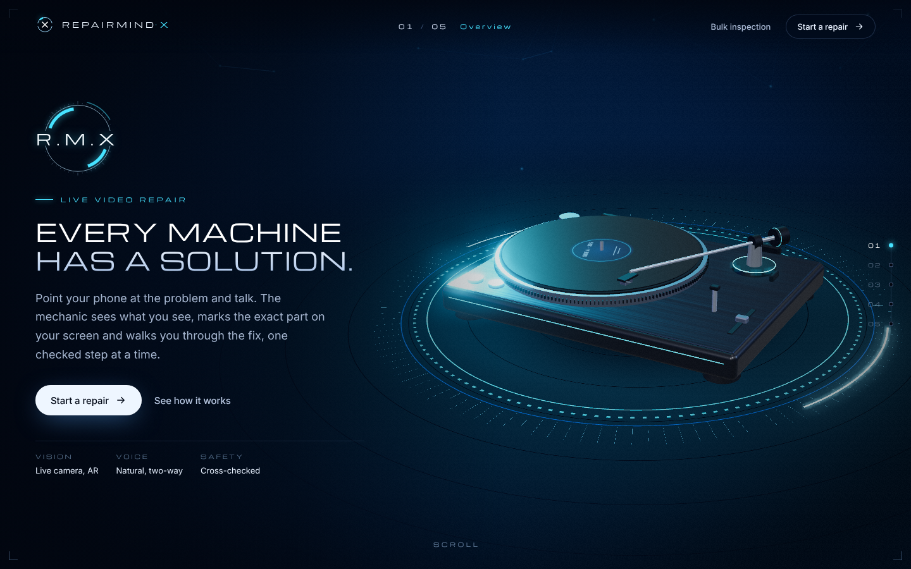 | 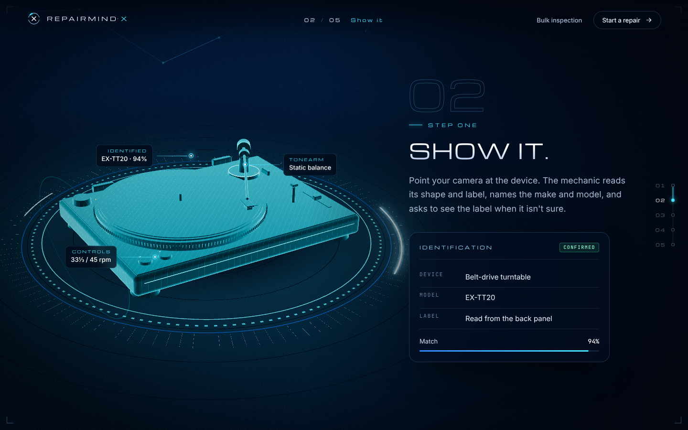 | 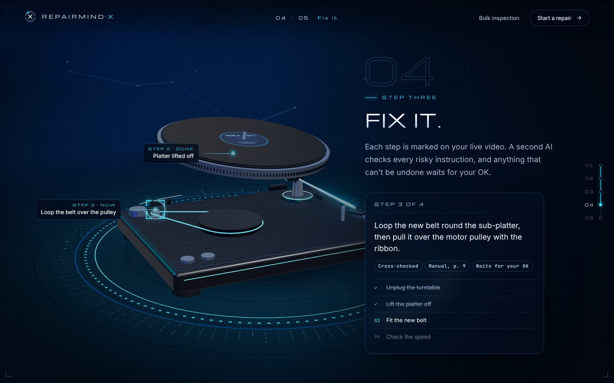 | 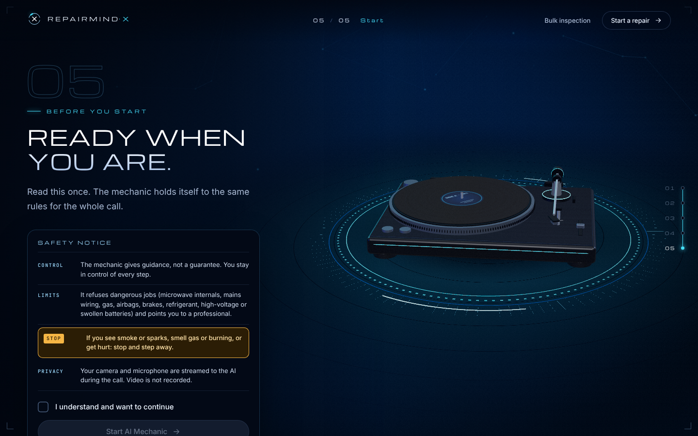 |

| Start page on a phone | Phone call | Hazard stop | Desktop call |
|---|---|---|---|
| 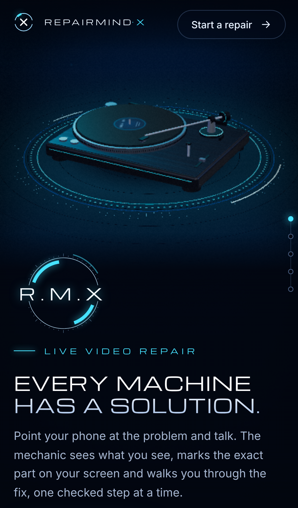 | 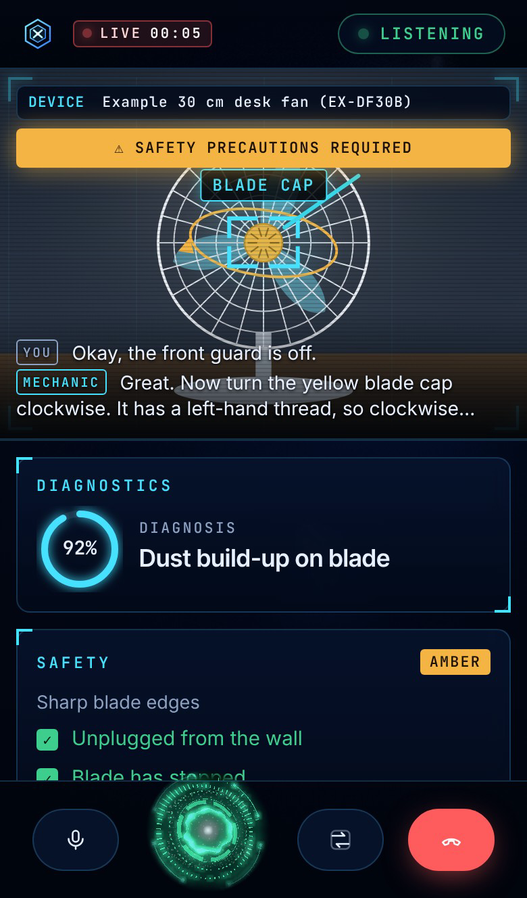 | 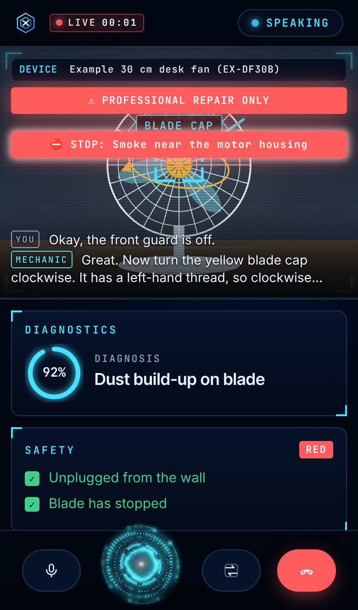 | 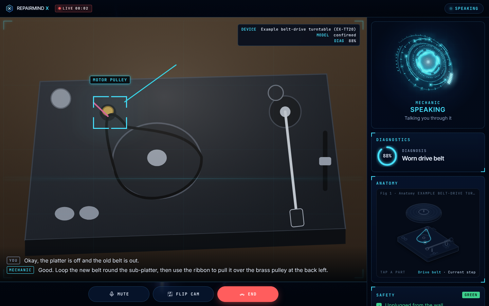 |

## Design lab (`#lab`)

Beyond repair: bring an idea, get an engineering breakdown that is checked, simulated and reviewed.

| Part | Where | What it does |
|---|---|---|
| Design agent | `agent/repairmind/lab/designer.py`, `POST /api/lab/design` | Turns an idea into requirements (each with a verification method), components, variables with sources, governing equations, a weighted trade study, an FMEA, a physics simulation spec and research notes. Uses Claude (`RMX_DESIGN_MODEL`, default `claude-opus-5-5`) or free Gemini, like the checks. |
| Units and maths engine | `web/src/lab/units.ts`, `expr.ts`, `analysis.ts` | The model never grades its own arithmetic. Every equation is recomputed in the page with dimensional analysis (adding metres to seconds, or calling joules newtons, is an error), in dependency order. Margins of safety are MS = allowable / (applied × FS) − 1. FMEA RPNs and trade-study totals are recomputed too. Edit any input and everything downstream updates. |
| Physics sandbox | `web/src/lab/physics.ts`, `SimView.tsx` | Rapier (WebAssembly rigid-body physics, loaded only on this page). Boxes, spheres and cylinders joined by fixed, revolute (with torque-limited motors), spring and prismatic joints. Probes compare the simulation against the equations that predict them, so the hand calculation and the simulation check each other. |
| Change it and see | `web/src/sim/edit.ts`, `SandboxEdit.tsx` | Edit the sandbox like the real assembly: gravity, each part's mass, size, grip and whether it is held, motor speed and torque, spring stiffness and damping, and what each joint is made with (hot glue, nylon or steel screws, printed pins). Joint loads come from F = m·a on the part a joint holds, minus the ground's push from Rapier's contact forces; a joint loaded past its strength breaks in the simulation, and a motor at full torque that can't turn its load is reported as stalled, each with the numbers and a fix. Edits apply to a copy, so the design and its hand calculations stay as they were. |
| No dead ends | lab and idea analyst prompts, `upgrade/assess.py` `enforce` | Ideas are never stopped at "not possible". Verdicts are build now, build with changes, needs research, or beyond known physics as asked (then the path goes to the goal behind the idea). Safety, legal and certification limits come back as a safe route (low voltage first, certified modules, a qualified person for one step), not a refusal. The only thing the engineer won't help build is a weapon or something meant to hurt people. |
| Think first | `agent/repairmind/lab/understand.py`, `POST /api/lab/understand`, `web/src/lab/ThinkFirst.tsx` | Before any design, the engineer restates the idea and the real goal, separates facts from guesses (you said, photo, typical, guess), checks feasibility with back-of-the-envelope numbers shown with units, and always lays a path (build, research and invent stages) from what can be built today to the full idea, with no dead ends, names the riskiest assumption with the cheapest test that could prove it wrong, offers 2-3 genuinely different concepts, and asks only the questions that would change the design. "That's not quite it" corrects it. The design is then built on what the user confirmed and answered, with the riskiest-assumption test first. "Design straight away" skips this. |
| Learn how it works | `web/src/lab/learn.ts`, `Learn.tsx`, `learn` in the design schema | A step-by-step path through the physics of *this* design, written for the level you pick (curious beginner, student, engineer; sent to the engineer as `level`). Each step asks you to predict what happens when one input changes; the page then recomputes the design's own equations with units and shows the real before and after, the scaling law read off the numbers (direct, square, inverse...), whether a safety check would now fail, and why. "Try it on the design" applies the change to the whole page and simulation. Designs without a learning path (the worked examples, older designs) get one built from their equations. |
| Rethink loop | `POST /api/lab/revise` | Failed checks and simulation mismatches go back to the agent as facts. It must find the root cause, weigh alternatives and redesign; the page re-checks and repeats up to 3 rounds ("Rethink until it holds"). |
| Voice and attachments | `web/src/lab/inputs.tsx`, `agent/repairmind/lab/attachments.py`, `POST /api/lab/attachments`, `POST /api/lab/transcribe` | Describe an idea by speaking (the browser's own dictation in Chrome, Edge and Safari; elsewhere a recording transcribed by Gemini) and by attaching anything: photos and sketches (the engineer looks at them), PDFs, Word, PowerPoint, spreadsheets, CSV and text (read as text), CAD measured by software (STL/OBJ bounding box, volume, area and watertightness; STEP units, part names and extents; DXF extents, layers and notes), audio (transcribed) and video (frames captured in the browser; speech and motion described by Gemini when `GOOGLE_API_KEY` is set). Each file is read on arrival so you see what the engineer will get. Only the processed result is kept, for 7 days. Attachments also work on "Redesign a broken part" and travel with the brief to the lab. |
| Lessons memory | `sessions/lab/lessons.jsonl` (`RMX_LAB_DIR`) | Each review round ends with general lessons, which are added to every later design prompt. This is how it improves over time without retraining a model. |
| Worked examples | `web/src/lab/examples.ts` | A ramp-climbing rover, a drop pod (fails its shock check on purpose, to show the rethink loop) and a suspension rig. They work with no server or key, and tests check that each simulation reproduces its own hand calculation. |

### Measuring the engineer (`agent/evals/`)

A fixed test set of 50 real ideas (`agent/evals/ideas.json`): new inventions, upgrades, ambitious ideas (jetpack, cubesat, exoskeleton), ones that break physics as asked (free energy, perpetual wheels, anti-gravity) and one that must be declined (a weapon). Each lists the acceptable feasibility verdicts and the ideas an expert answer must contain (for the 10 m well: the suction limit or a submersible pump; for a balcony turbine: the cube law or Betz). The scorer (`repairmind/evals.py`) also checks the shape of a strong answer: rough numbers with units, a path that starts with something buildable, at least two concepts, a measurable pass condition for the riskiest assumption, and at most four questions.

```bash
cd agent && .venv/bin/python scripts/eval_ideas.py              # all 50, about 15-25 minutes on free Gemini
.venv/bin/python scripts/eval_ideas.py --only free-energy,solar-pump-10m --level student
```

Each run is saved in `agent/evals/results/` and compared with the previous one, listing ideas that got 10 or more points worse or better. Run it before and after changing a prompt, a model or the library, so "it feels smarter" becomes a number.

## Three screens: intro, start page, assistant

The app has three screens. The **intro** and the scrolling **start page** are unchanged. Everything after them happens
on one **assistant** screen (`#assistant`, `web/src/workspace/`), laid out like a chat app: chats and tools on the
left, the conversation in the middle, and a panel on the right where any tool opens. Nothing is a separate page any
more: the live repair call, the design lab, the parts canvas, redesign, bulk inspection and the references all open
as panels beside the conversation, and the assistant can open them itself. Old addresses (`#lab`, `#build`,
`#redesign`, `#inspect`, `#demo`) open the assistant with that panel.

| Part | Where | What it does |
|---|---|---|
| One assistant | `agent/repairmind/guide/`, `POST /api/guide/turn` | One general engineer for everything: fixing (it offers the live call, or diagnoses from photos in the chat), making and improving things, mechanisms, redesign, inspection, and plain questions answered from the cited library. One model call per turn through `checker.parse` (Gemini or Claude, same retries and backups), with the project's live state. It picks tools; the page runs them on the real engines and returns the results as facts, and it carries on by itself (up to 4 rounds). Plain-code `safety.py` can only make it more careful. |
| Tools it drives | `web/src/workspace/tools.ts`, `Workspace.tsx` | The idea analyst, the parts checker and fixes, behaviours, the virtual bench, the 3D body, the design lab's engineer and rethink loop, build steps, plus: open any panel, start the live repair call, search the library, ask for a photo (opens the camera), check a photo of the real build, show the buying list, download the build pack. |
| Ways in | `Workspace.tsx` | Type; dictate (mic); **voice mode** (hands-free: it listens, answers out loud, listens again; works in Chrome, Edge and Safari); take a photo with the camera; share the screen (one frame is sent); upload files or a whole folder; drag and drop. |
| Chats | browser storage (`rmx.chats`, `rmx.chat.<id>`) | Each chat keeps its own conversation and project; switching chats switches the project every panel sees. |

### Building real things precisely

What the best hardware tools do well, tied to the checker so it can't drift from the design, plus what they miss:

| Feature | Where | Compared with others |
|---|---|---|
| Wire by wire | `web/src/workspace/precision.ts` `wireList` | Every connection is one numbered wire with the usual colours (red +, black ground, orange 3.3 V, a different colour per signal), to tick off as it's placed. Fritzing and Cirkit Designer draw a picture; this is a list you build from, and the assistant names wires by number. |
| Photo check of the real build | `agent/repairmind/guide/photo_check.py`, `POST /api/guide/check-build` | A photo of the breadboard is compared wire by wire with the list: looks right, wrong (with the fix) or can't see. It may only say "right" when it sees both ends; plain code then decides "don't power on yet" if anything is wrong or unclear. Wokwi, Tinkercad and Flux check the circuit you drew, never the one on your desk. |
| Readings to expect | `precision.ts` `readings` | What a correct build reads on a multimeter, power-off short check first, then supply, booster, board and 3.3 V pins and total current, with what it means if the reading is off. Ranges come from the parts' data, not the model. Simulators stop at the simulation. |
| Parts to buy | `precision.ts` `buyList`, `buyCsv` | Quantities and rupee prices from the checker, with Robu, Amazon.in and Robocraze search links and a CSV. |
| Build pack | `precision.ts` `buildPack` | One Markdown file (parts, wire checklist, pins, readings, steps, libraries, code) plus the `.ino`, readable on a phone at the bench. |

The assistant uses these during the build-along: it names the wires for each step, asks for the multimeter reading
and compares it with the expected range, and asks for a photo and checks it before power goes on.

| Start | Wire by wire, checked from a photo | Live repair call in the panel | Phone, voice mode |
|---|---|---|---|
| 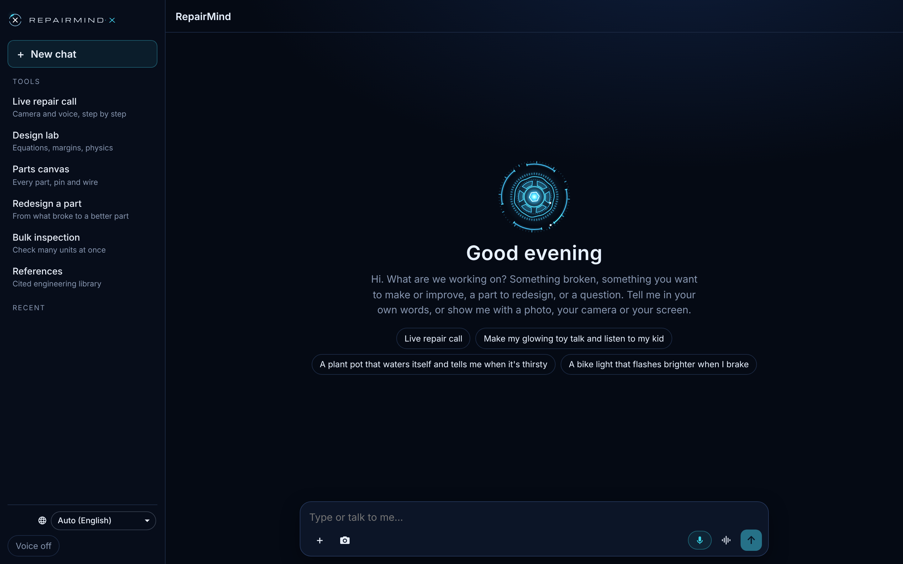 | 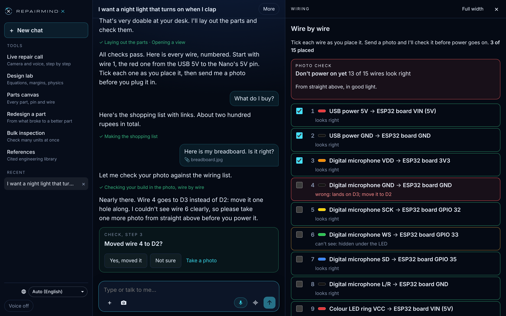 | 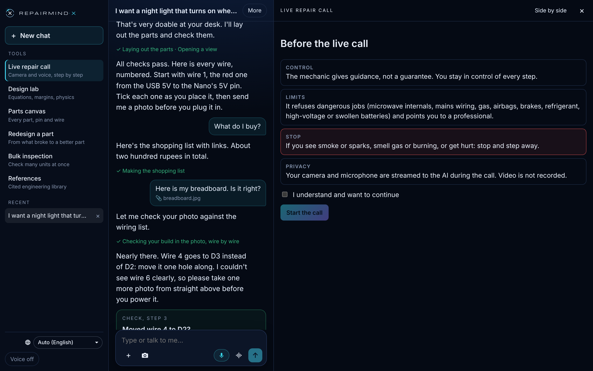 | 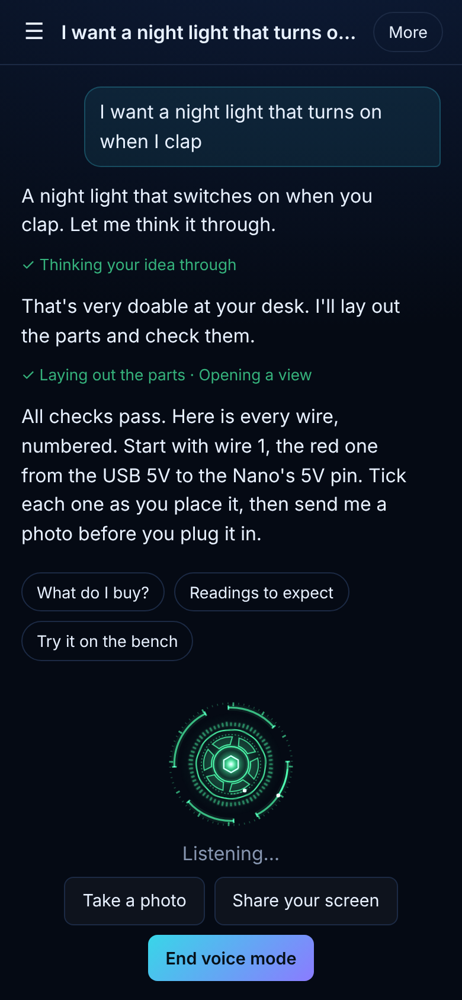 |

The screenshots use scripted assistant replies (no AI key was available when they were taken); the tools behind them
(checker, wire list, readings, buying list) ran for real.

## Idea to reality (`#build`)

For people with an idea but no hardware background. Describe a new invention, or something you own and how
it should be better, in plain words (typed or spoken), and drop in photos or documents.

| Step | Where | What happens |
|---|---|---|
| Understand | `agent/repairmind/upgrade/assess.py`, `POST /api/upgrade/assess` | The analyst (Claude or free Gemini) restates the idea, works out what the product is and what is likely inside (marked seen, likely or guess), and asks a few plain questions with tap-to-answer choices. |
| Judge | same | Each wish is possible, possible with changes, or not possible, backed by physics, power, space, cost, safety, skill and legal factors, with the closest buildable alternative when it can't be done. `safety.py` runs on the product and wishes in plain code and can only make the answer stricter (no relays or internal changes on mains or red-level products). |
| Plan | same | A staged path from a cheap desk prototype to a finished product, the catalogue parts and reactions for the buildable wishes, other things needed beyond the catalogue, and a hand-off to the design lab when there are mechanisms or loads. |
| Learn | `RMX_UPGRADE_DIR` (default `sessions/upgrade`) | Every judgement is kept as a precedent and every user correction ("it runs on 3 AAA cells") as a learned fact; both go into later prompts so a corrected mistake isn't repeated. |
| Build | `web/src/build/` | "Build it" opens the plan on a drag-and-drop parts canvas. The checker (`engine.ts`) verifies pins, voltages, the power budget, battery life and fit, offers one-tap fixes, and produces a wiring diagram, a parts list in rupees, a starter Arduino sketch (`firmware.ts`) and build steps with safety notes. |
| Try it | `web/src/sim/` (`circuit.ts`, `bench.ts`, `program.ts`, `avr.ts`, `Bench.tsx`) | The project on a virtual bench. Switch it on, press its buttons, clap, change the room light, the distance or the temperature, and watch each part. A small SPICE-style solver (modified nodal analysis, Newton–Raphson, LED and diode Shockley models, regulators, boost converters, battery internal resistance) works out every voltage and current each 5 ms. Change values and wiring, or try a mistake, and parts fail the way real ones do, with the numbers that explain it and a one-tap undo: LEDs burn without their resistor, pins die over 40 mA, run-down batteries make the board restart (brownout), shorts melt wires or trip the charger, a booster trimmed too high destroys the board, a 3.3 V part on 5 V dies, 5 V into an ESP32 pin wears it out, servos stall or strip their gears under a weight on the arm, and a pump without a flyback diode kills its switch. The bench runs the "When… then…" list with the generated sketch's own timing and thresholds; on a Nano it can also run real compiled code (a `.hex` exported from the Arduino IDE) on avr8js, Wokwi's open-source ATmega328P emulator, with servo pulses, `tone()`, NeoPixel data, the ADC and Serial wired to the bench. |
| Body | `web/src/sim/shell.ts`, `outline.ts`, `Body.tsx` | The product's outside in 3D, for any product. Trace its outline from a photo (background removal, largest shape, edge following) or start from a shape, enter the measured size, and remodel it: depth, edge rounding, wall thickness, material. The electronics are packed inside and checked for fit with 2 mm to spare ("Make it just big enough" finds the smallest scale that works). The maths is shown: volumes, mass, print time and cost, and a squeeze test from Roark's flat-plate formulas with the safety factor and the wall needed for a factor of 2. Both halves download as closed, printable STL. |

Without an AI key, `web/src/build/assess.ts` gives a basic offline analysis from built-in product knowledge,
so the flow still works. The generated sketches are syntax-checked in development, not compiled against the
real Arduino toolchain: compile before flashing.

## Languages

The whole app speaks 16 languages: English, Hindi, Bengali, Telugu, Marathi, Tamil, Gujarati, Kannada, Malayalam,
Punjabi, Spanish, French, German, Arabic (right to left), Chinese and Japanese. Pick one from the globe menu in any
header, or leave it on Auto to follow the browser.

- **Screens.** Every English string is in `web/src/i18n/en.ts`. The safety notice, hazard alert, precautions and
  main controls are translated by hand (`web/src/i18n/locales/`). Everything else, and text that arrives during a
  call (diagnosis, steps, check findings), is translated once by the server with the configured model and cached
  in `sessions/i18n/`. A translation that drops a number, a unit or a placeholder is rejected and the English is
  shown instead. With no model configured the app stays in English apart from the hand-written text.
- **The mechanic** speaks the chosen language from its first word (on Auto it answers in whatever you speak,
  including mixed Hindi and English). It still writes every tool argument in English, so the deterministic safety
  rules, the step gates and the second-opinion review work the same in every language. Hazard words ("धुआं",
  "करंट लगा", "புகை", "humo"...) stop the call in all 16 languages and in romanised Hindi.
- **The design lab** writes designs in the chosen language. Symbols, expressions, units, ids and numbers stay as
  they are, so the unit checks and the simulation are unaffected.
- **Voice input** (dictation and server transcription) listens in the chosen language.

Optional settings: `RMX_TRANSLATE_MODEL` (Claude model for interface translation when `ANTHROPIC_API_KEY` is set),
`RMX_GEMINI_SET_LANGUAGE=1` (also pass the speech language code to Gemini Live; off by default because native-audio
models choose the language themselves).

## Run it

You need: a free LiveKit Cloud project (URL, API key, secret) and a free Google AI Studio API key. That's all; the app runs entirely on free tiers.

**When the model is busy.** Every AI call (design lab, idea analyst, checks, translation) retries temporary errors (503 "overloaded", 429 rate limits, timeouts) with exponential backoff, then moves to backup models: `RMX_GEMINI_FALLBACK_MODELS` (default `gemini-3.8-flash`), plus `RMX_GEMINI_DESIGN_FALLBACK_MODELS` (default `gemini-3.5-flash-lite`) for design and analysis only, never for the safety second opinion or camera checks, then the other provider when both keys are set and `RMX_CHECK_PROVIDER` is `auto`. A refusal is never retried on another model. The whole call is capped (`RMX_DESIGN_MAX_SECONDS`, default 240 s for designs; 60 s or less for live-call checks), so a busy provider can't keep the page waiting for minutes. If everything fails, the page says in plain words which models were tried, what went wrong and what to do, and offers Try again; a worked example or basic analysis is never shown as if it were the answer to your idea.

**Free vs paid checking.** The second-opinion review, label reading, part markers and camera step checks use a separate Gemini model (`gemini-3.5-flash` by default; Google no longer offers `gemini-2.5-flash` to new keys) on the Google free tier, with the same key as the live voice. The rules are identical either way: a disagreement, an error or a used-up free quota blocks the risky step, it never lets it through. Adding an optional `ANTHROPIC_API_KEY` switches these checks to Claude, which is a fully independent model family and the stronger second opinion; `RMX_CHECK_PROVIDER` forces one or the other. The free tier has per-minute and daily limits, so a long session can hit them; when it does, risky steps wait or are handed to a human rather than going ahead unchecked.

```bash
# 1. Agent + token server
cd agent
cp .env.example .env            # fill in the keys
uv venv && uv pip install -e ".[dev]"
.venv/bin/python -m pytest
.venv/bin/python -m repairmind.agent dev          # terminal 1: the mechanic
.venv/bin/uvicorn repairmind.token_server:app --port 8000   # terminal 2

# 2. Web app
cd ../web
npm install
npm run dev                     # open the printed URL; on a phone use the network URL over HTTPS
```

Phones only allow camera access over HTTPS (or localhost). For phone testing, deploy the web app (any
static host) or use a tunnel such as `cloudflared tunnel --url http://localhost:5173`.

## Known limits of Phase 1

- **Not yet tested against live services.** The safety rules, gates and token server are covered by
  unit tests, and the web app builds. The end-to-end call needs the LiveKit and Gemini keys, and the
  iFixit lookup was not reachable from the build machine.
- **The speech guard acts after the sentence is spoken.** It interrupts and corrects within about a
  second, but the words were already heard. It also allows any instruction while a step is active.
- **Markers use freeze-frame.** The box is drawn on the exact frame that was analysed, not the moving
  live video. Live tracking of markers is not built yet.
- **iFixit licence.** Guides are CC BY-NC-SA. Fine for this prototype; a commercial launch needs
  iFixit's paid API plan, and their content may not be used to train models.
- **Safety keywords are English only** for now.
- **Manuals must have a text layer.** Scanned PDFs are rejected; OCR would come later.
- **The token server and agent share a disk** for uploaded manuals, so run them on the same machine
  (or point `RMX_SESSIONS_DIR` at shared storage).

## Redesign a broken part

When the fault is a part that broke, wore out, melted or corroded, RepairMind turns the call into a design
brief for the design lab, and keeps a library of what failed and whether the fix held.

| Part | Where | What it does |
|---|---|---|
| Capture on the call | `record_failed_part` tool, `RepairSession.failed_part` | The mechanic notes the part, what it does, how it failed (seen or suspected), what the break looks like, and sizes and loads. A value without a unit is refused, not guessed. |
| Failure modes | `agent/repairmind/redesign/failure_modes.py` | Overload fracture, fatigue, wear, corrosion, heat, creep, buckling, electrical: the signs to look for, usual causes, known fixes, the questions that tell them apart, and the analyses a redesign must pass (fatigue needs fatigue life and vibration checks, heat needs thermal and creep, and so on). |
| Units | `agent/repairmind/redesign/units.py` | Lengths, forces, torque, pressure, temperature, speed, mass, power and more, converted to SI once. Sizes must be lengths. |
| Brief check | `agent/repairmind/redesign/brief.py` | Lists what's missing, unit errors and every estimate as an assumption. Red-level jobs are blocked. Parts that hold a person up or hold pressure (ladders, chairs, mounts, wheels, pressure cookers...) can be drafted but are marked for a qualified engineer's sign-off. |
| Design lab hand-off | "Send to design lab" | Builds the lab's `{idea, context}` (most important facts first, each under 4,000 characters) and opens `#lab` with it filled in. |
| Failure library | `agent/repairmind/redesign/library.py` | Only briefs the person chooses to add. Keeps device, part, failure, material, sizes and loads; never the call, names, photos or notes. Searchable, with counts by failure mode and "did the fix hold?" for each record. |
| Web page | `#redesign` ("Redesign a part" on the start page) | Start from the last repair call on this device or from a blank brief, edit, check, send to the lab, add to the library. |
| API | `/api/redesign/...` | `failure-modes`, `briefs/from-session`, `briefs`, `briefs/{id}`, `briefs/{id}/lab`, `briefs/{id}/share`, `library`, `library/stats`, `library/{id}/outcome`. |

